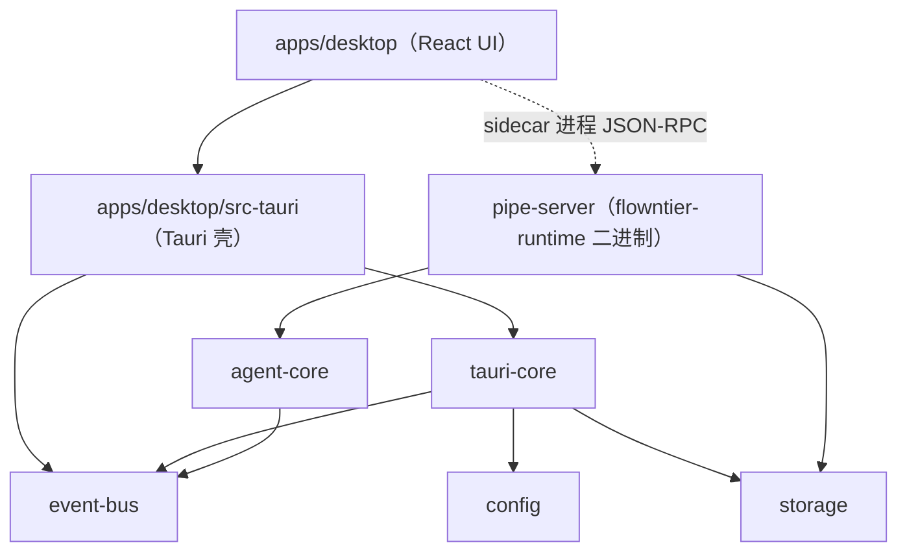

# 工程手册（ENGINEERING）

> 本文件是 Flowntier 工程结构、模块边界与协作流程的单一入口，面向人类贡献者与自动化 Agent。
> 修改代码结构或流程时请同步更新本文件。

**版本：** v0.1  
**最后更新：** 2026-11-23  
**相关文档：** [ARCHITECTURE.md](./ARCHITECTURE.md)、[TECH_STACK.md](./TECH_STACK.md)、[CONTRIBUTING.md](../CONTRIBUTING.md)、[.agent/](../.agent/) 规则集

---

## 1. 硬性规则

1. **单文件不超过 1000 行**（含测试、脚本与文档）。超限必须拆分；拆分优先「纯移动」，行为变更单独提交 / 单独 PR。
2. **单个 PR 的总变更尽量不超过 1000 行**；确实超过时先与维护者确认（因冲突合并的 PR 除外）。
3. **任何云端仓库修改先建 Issue，再走 PR**；不直接 push `main`，不 force-push 受保护分支。
4. 模块依赖只能沿既定方向（见 §2.3），**禁止循环依赖**。
5. **文档与代码同步**；接口、行为或流程变化必须更新对应 `docs/` 文档。
6. 不提交密钥；配置文件与 PR 描述中不得出现 secret（密钥只进 OS keychain / 环境变量）。
7. 提交信息遵循 [.agent/commit_rules.md](../.agent/commit_rules.md)：`<type>(<scope>): <subject>`，英文、祈使、小写、无句号、标题 ≤72 字符。

---

## 2. 仓库结构

### 2.1 总览

| 路径 | 职责 | 关键约束 |
|------|------|----------|
| `crates/event-bus` | 类型化 pub/sub 事件总线（Rust 核心与 UI 事件流共用） | 只依赖 serde / tokio / thiserror 等基础库；不依赖 storage、config、tauri |
| `crates/config` | 解析与校验 `flowntier.toml`、`providers.toml`、`router.toml` | 只做解析/校验，不承担运行时全局加载 |
| `crates/storage` | SQLite + FTS5 持久层（workflows / tasks / usage / memory / prompts / plugins） | 唯一直接接触 SQLite 的 crate；迁移只能向前 |
| `crates/agent-core` | agent 主循环、工具注册表、provider 客户端、prompt 引擎 | 不依赖 tauri；依赖 `event-bus` |
| `crates/pipe-server` | JSON-RPC + 事件推送 IPC（Windows 命名管道 / Unix domain socket）与 loopback HTTP/SSE 桥 | 产出二进制 `flowntier-runtime`；依赖 `agent-core`、`storage` |
| `crates/tauri-core` | Tauri 入口、command 与胶水层 | **唯一**依赖 `tauri` 的库 crate；依赖 `config`、`storage`、`event-bus` |
| `apps/desktop/src-tauri` | Tauri 2 外壳（`flowntier-desktop`），以 sidecar 方式启动 `flowntier-runtime` | 不直接依赖 `pipe-server` |
| `apps/desktop` | React 19 + Vite 桌面 UI（Mission Control） | 数据只经 Tauri IPC 与事件流进入 |
| `apps/html-frontend` | 早期静态 HTML 前端（`dist/` 产物） | 历史遗留，不再扩展 |
| `packages/shared` | 跨语言类型（事件 / 错误 / IPC）的唯一来源 | Rust 与 TS 双端对齐，改字段需评估双方 |
| `packages/ui` | 共享 React + Tailwind v4 + shadcn/ui 组件 | **唯一**引入 shadcn/ui 的包 |
| `packages/workflow` | 工作流状态类型、TanStack Query hooks、事件订阅 | 只消费事件总线，不产生事件 |
| `packages/prompts` | 确定性 prompt 模板渲染（Handlebars 风格，无 eval） | 渲染结果必须可复现 |
| `packages/providers` | provider 元数据表（能力 / 上下文窗口 / 价格） | 只读数据，不发 SDK 请求 |
| `docs/` | 面向使用者的规格、架构、FAQ、安全等文档 | 与代码同步更新 |
| `plans/` | 阶段计划、RFC 草案与发布计划 | 非实现代码 |
| `config/` | 默认 TOML 配置样例 | 不含 secret |
| `acceptance/` | 真实任务验收样例（供 agent 端到端跑通） | 修改需说明验收意图 |
| `prompts/` | 内置 prompt 资源 | 与 `packages/prompts` 的渲染契约保持一致 |
| `scripts/` | 构建、补丁、截图等辅助脚本 | 不参与运行时 |
| `tools/` | 维护工具（`brace_check.py`、`bump_version.sh` 等） | 一次性工具，保持可独立运行 |
| `.agent/` | Agent 与人类共同遵守的规则（架构 / 编码 / 提交 / UI） | 规则变更走独立 PR |
| `.validation/` | PowerShell 端到端验证脚本 | Windows 命名管道行为在此验证 |
| `.github/workflows/` | CI（`ci.yml`）与发布（`release.yml`） | 见 §6 |
| `history/` | 历史归档（旧品牌 / 旧版本资料） | branding 检查排除该目录 |

### 2.2 依赖方向



### 2.3 模块边界约定

- **Rust**：依赖方向为 `pipe-server → agent-core → event-bus`、`pipe-server → storage`、`tauri-core → {config, storage, event-bus}`；`tauri-core` 是唯一依赖 `tauri` 的库 crate。
- **TypeScript**：`packages/shared` 是包间唯一允许的跨包依赖来源；`packages/ui` 独占 shadcn/ui；`apps/desktop` 是唯一启动 Tauri 的应用。
- **进程边界**：webview ⇄ Rust 只用 Tauri IPC；UI / Rust ⇄ runtime 用 JSON-RPC（命名管道 / Unix socket，或带 bearer token 的 loopback HTTP）；runtime ⇄ LLM 用 HTTPS。不用共享文件充当消息队列。
- **测试边界**：集成测试放 `crates/<crate>/tests/`；单个测试文件超 1000 行时，拆为 `tests/<suite>.rs` + `tests/<suite>/` 子模块，共享 helper 只收口到 `common`，且仅以 `pub(crate)` 暴露。拆分只允许移动，测试函数名与数量保持不变。
- **配置边界**：配置只经 `config` crate 解析；除 provider 层外不直接读环境变量。

---

## 3. 单文件 ≤1000 行与拆分流程

触发条件：任一文件（含测试）超过 1000 行，或单次 PR 变更逼近上限时。

1. **建 Issue** 说明拆分范围与目标结构，明确声明「纯移动、不改行为」。
2. **隔离工作区**：`git worktree add` 新目录 + `<type>/<slug>` 分支，不在共享工作树直接改。
3. **最小移动**：新文件只放移动过来的内容；共享 helper 收口到 `common` 模块；不顺手重命名、不调整逻辑。
4. **模块挂接**：顶层文件保留 `mod` 声明。注意 `tests/` 下的 crate root 需要显式 `#[path = "<suite>/<mod>.rs"]`，否则 `mod x;` 会解析到 `tests/x.rs`。
5. **格式化**：只对本次涉及文件执行 `rustfmt`，避免把无关文件带进 diff。
6. **验收**：`cargo fmt --check`（本次文件）、`cargo check --tests -p <crate>`、`#[test]` / `#[tokio::test]` 计数与拆前一致、`git diff` 仅含移动。
7. **提交**：`refactor(<scope>): ... [skip ci]`；行为变更另开提交与 PR。

---

## 4. 分支与 PR 命名

- **分支**：`<type>/<slug>`，`type` ∈ `feat | fix | refactor | docs | chore | test | perf`，`slug` 用小写连字符。示例：`refactor/split-e2e-docs`、`fix/pipe-server-quota-reset`。
- **PR 标题**：`<type>(<scope>): <subject>`，与提交标题同规则；`scope` 建议用 crate / 目录名（`pipe-server`、`storage`、`ui`、`docs`、`ci` 等）。
- **PR 正文**：关联 Issue（`Closes #N` / `Refs #N`）+ 验证命令与结果 + 风险与回滚方式。
- **规模**：单 PR 尽量 ≤1000 行；拆分类 PR 只做移动，便于逐行比对。
- **合并**：优先 squash merge，保持 `main` 线性；合并后删除本地与远端分支，清理 worktree 与构建产物。
- **流程**：Issue → 分支 → PR；涉及新功能先走 `plans/` 下的 RFC 草案。

---

## 5. CI 与 `[skip ci]` 策略

**核心策略：每个 PR 不跑 CI；门禁在合并阶段本地执行，`main` 上的 CI 只做最终兜底。**

- **PR 阶段**：提交信息（或 PR 标题）末尾加 `[skip ci]`，让 GitHub Actions 跳过 PR 触发的运行；作者 / Reviewer 用 §6 的本地命令自检。
- **合并阶段**：由 maintainer 在干净 worktree 上整体运行本地门禁（§6.5）。全部通过后才合并；合并推送 `main` 会触发 `ci.yml` 做兜底验证。
- **`ci.yml` 的 5 个 job**：`lint-branding`（旧品牌字符串回归）、`rust-tests`（`cargo fmt` + `clippy -D warnings` + `cargo test`）、`typecheck`（`pnpm install` + `tsc` + `eslint` + `prettier`）、`e2e-windows`（Windows sidecar + PowerShell e2e）、`summary`（required status check）。
- **`release.yml`**：负责打包与发布，不参与 PR 门禁。
- **例外**：涉及 Windows 命名管道 / sidecar 行为的改动，合并前需在 Windows 环境跑一次 `.validation/e2e_tauri_commands.ps1`。
- `[skip ci]` **只用于跳过 PR 阶段的冗余 CI**，不得用于绕过 `main` 的分支保护检查。

---

## 6. 本地验收命令

### 6.1 环境

- Linux 构建依赖（CI 与本地一致）：`libwebkit2gtk-4.1-dev`、`libgtk-3-dev`、`libayatana-appindicator3-dev`、`librsvg2-dev`、`patchelf`、`libssl-dev`。
- 受限于发行版或容器环境时，可自行准备等价的 sysroot 或安装上述系统包；仓库本身不依赖任何本地评审脚本。

### 6.2 Rust

```bash
cargo fmt --check
cargo clippy --workspace --all-targets -- -D warnings
cargo test --workspace --all-features
cargo check --tests -p pipe-server        # 快速确认测试目标可编译
```

### 6.3 TypeScript / 前端

```bash
pnpm install
pnpm -C apps/desktop exec tsc --noEmit
pnpm -C apps/desktop run lint              # eslint src --max-warnings 0
pnpm -C apps/desktop run test              # vitest run
pnpm -C apps/desktop run format:check
```

仓库根没有 `package.json`，统一用 `make` 或 `pnpm -C apps/desktop`。常用目标：`make test`、`make lint`、`make format`、`make lint-branding`；`make ci` = `make lint` + `make test`。

### 6.4 codeidx 代码索引（评审环境）

`codeidx` 以 MCP server（stdio）方式提供代码索引，用于拆分/重构前后核对符号与文件轮廓：

```bash
codeidx-mcp    # 启动 MCP server（stdio）
# 调用顺序：mount_project(auto_sync=false) → get_file_outline(file_path=...) → unmount_project
```

评审工作区的封装脚本（输出指定文件的 outline，便于和基线比对）：

```bash
python3 .review/outline.py "$(command -v codeidx-mcp)" <project-path> <file>...
```

### 6.5 合并阶段门禁（`.review/gates.sh` 等价）

```bash
cargo fmt --check
cargo check -p storage -p agent-core -p pipe-server --lib
( cd apps/desktop && ./node_modules/.bin/tsc --noEmit -p tsconfig.json )
( cd apps/desktop && ./node_modules/.bin/eslint src --ext .ts,.tsx )        # 结果作参考
( cd apps/desktop && ./node_modules/.bin/vitest run --passWithNoTests )
```

CI 全量门禁比本地更严格：额外要求 `clippy -D warnings`、全量 `cargo test`、branding lint 与 Windows e2e。

---

## 7. 拆分后目录一览：`crates/pipe-server/tests/e2e_pipe`

原 `e2e_pipe.rs`（2695 行）按功能域拆为子模块；顶层 `e2e_pipe.rs` 只保留模块声明，47 个 `#[test]` / `#[tokio::test]` 全部保留，纯移动、无行为变更。

```text
crates/pipe-server/tests/
├── e2e_pipe.rs              (32)  模块声明（#[path] 挂接）+ 套件说明
├── e2e_pipe/
│   ├── common.rs            (116) 共享 helper：free_pipe_name、client、spawn_server
│   ├── basic.rs             (62)  ping / 未知方法 / providers 端点冒烟
│   ├── providers.rs         (624) provider CRUD、secret、preset 与模型目录
│   ├── router_config.rs     (545) 角色、模型目录与 router roles 配置
│   ├── quota.rs             (231) 配额失败追踪（event 000056）
│   ├── http_bridge.rs       (172) loopback HTTP + SSE 桥（event 000057）
│   ├── production_pipe.rs   (252) Windows 生产管道名回归（#[cfg(windows)]）
│   ├── disabled_models.rs   (253) 按 provider 禁用模型（event 000110）
│   └── workflow_verdict.rs  (460) reviewer_verdict / repair_loop 事件契约
├── e2e_audit_000132_cascade.rs
├── e2e_audit_000135_disabled_models.rs
└── hardening_fix7.rs
```

约束：`common` 是唯一共享 helper 入口；`production_pipe` 仅在 Windows 编译；后续新增测试按功能域加入对应模块，单文件逼近 1000 行时继续按同一规则拆分。

---

## 8. 维护

- 本文件由维护者评审；目录结构、门禁命令、CI 策略变化时同步更新。
- 拆分 / 重构类 PR 在正文附「拆前 / 拆后」文件与行数对照，并注明测试数量未变。
- 变更记录：

| 日期 | 版本 | 变更 |
|------|------|------|
| 2026-11-23 | v0.1 | 初版：仓库结构与职责、模块边界、拆分流程、分支/PR 命名、CI 与 `[skip ci]` 策略、本地验收命令、e2e_pipe 拆分后目录一览 |

